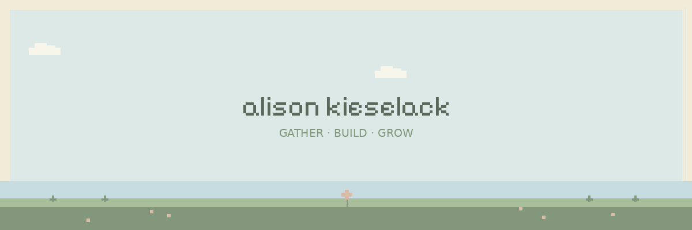

<picture>
  <source
    media="(prefers-color-scheme: dark)"
    srcset="assets/name-banner-night.gif">
  <source
    media="(prefers-color-scheme: light)"
    srcset="assets/name-banner-day.gif">
  
</picture>

## About

I'm a software and cloud engineer with a background in mathematics, analytics engineering and product data science.

## Projects

| Name | Type | Description | Link |
| --- | --- | --- | --- |
| SupernovaBnB | Group | Full-stack Airbnb-style website featuring space listings, booking flow, user authentication and account area | [Repo](https://github.com/alisonkieselack-prog/supernova_bnb) |
| Little Life | Personal | Cute Tamagotchi-style pet you can feed and play with — just for fun | `In progress` |

## Tech Stack

- **Languages:** Python, SQL, R
- **Cloud:** AWS, Docker, Terraform
- **Data:** PostgreSQL, BigQuery, dbt
- **Tools:** Git, GitHub Actions, Jenkins, CI/CD